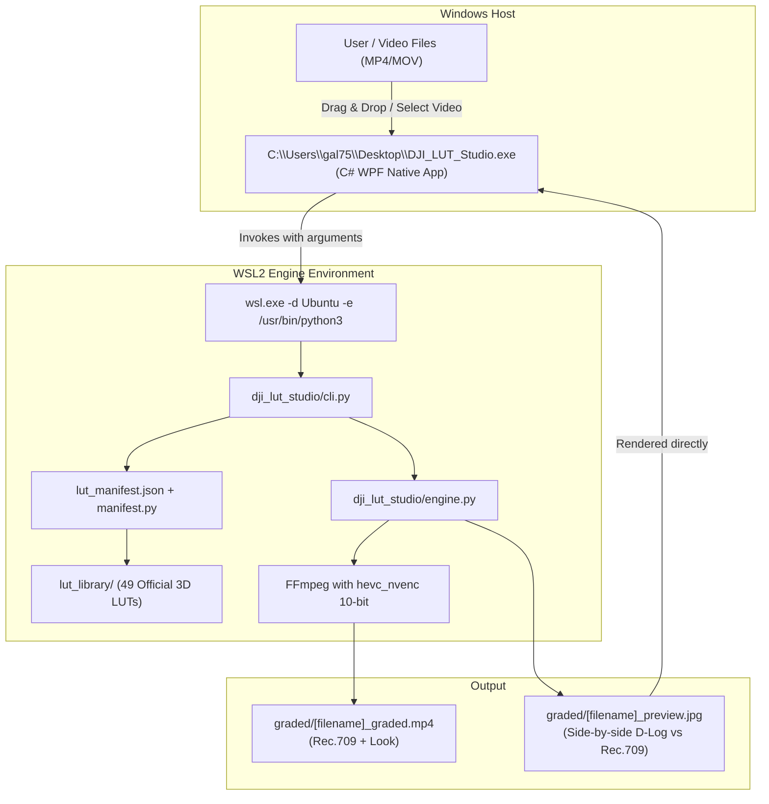
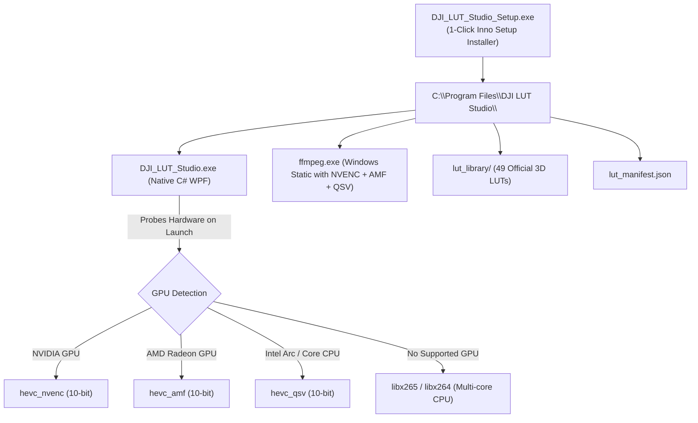

# 📖 DJI LUT Studio — Project Continuation & Developer Handover Guide

> **Project:** DJI LUT Studio (Native Windows + WSL Open-Source Edition)  
> **Repository Location (WSL):** `/home/gal756/LUT-adder`  
> **Windows Location:** `\\wsl$\Ubuntu\home\gal756\LUT-adder`  
> **Executable Location:** `C:\Users\gal75\Desktop\DJI_LUT_Studio.exe`  
> **Last Updated:** October 2026 (v2.0.0 Native Engine)  

---

## 📌 Executive Summary
**DJI LUT Studio** is an open-source, hardware-accelerated video color grading suite built for Windows users. It converts flat 10-bit D-Log and D-Log M footage from DJI drones and action cameras into broadcast-standard Rec.709 video (or custom creative looks).

The application features:
1. **A Native Windows Desktop GUI (`DJI_LUT_Studio.exe`)** written in C# / WPF (.NET 4.8) with modern dark styling, responsive controls, live console logs, and preview image rendering.
2. **A High-Performance Backend Engine** powered by Python 3 and FFmpeg with full **NVIDIA RTX 3070 NVENC 10-bit hardware acceleration** and tetrahedral 3D interpolation.
3. **49 Verified 3D `.cube` LUTs** covering all official DJI drones, handhelds, action cameras, and master creative looks.

---

## 🏛️ Architecture & Data Flow



---

## 📂 Project Directory Structure

```text
/home/gal756/LUT-adder/
├── DJI_LUT_Studio.exe          # Native Windows 64-bit WPF Executable
├── build_exe.sh                # Shell script compiling C# via Windows csc.exe
├── lut_manifest.json           # Catalog of all 49 LUTs with device IDs, regex patterns
├── CONTINUATION_GUIDE.md       # This file (handover and continuation reference)
├── README.md                   # User documentation and features
├── CONTRIBUTING.md             # Open-source contribution guidelines
├── LICENSE                     # MIT License
├── DJI_LUT_Studio.bat          # Desktop drag-and-drop batch launcher
├── DJI_LUT_Web_Studio.bat      # Web studio browser launcher
│
├── src/
│   └── DJI_LUT_Studio.cs       # Full source code for WPF Windows Desktop GUI
│
├── dji_lut_studio/
│   ├── __init__.py             # Package init
│   ├── manifest.py             # LUT manifest parser, device resolution, auto-matching
│   ├── engine.py               # Grading engine, NVENC detection, FFmpeg filters
│   ├── cli.py                  # Standalone CLI interface
│   └── web_server.py           # Local HTTP web studio server
│
├── lut_library/                # 49 Curated and verified .cube LUTs
│   ├── drones/                 # O4, Avata 2/360, Mavic 3/4, Mini 4/5, Air 3/3S, Flip
│   ├── action_pocket/          # Pocket 3/4/4P, Action 4/5/6, Osmo 360/Nano
│   ├── cinema/                 # Zenmuse X7, Ronin 4D, Phantom 4
│   └── looks/                  # Vibrant, Cinematic, Golden Hour, Teal/Orange, Noir, etc.
│
├── web/
│   └── index.html              # Modern glassmorphism web GUI
└── gui/
    └── app.py                  # Legacy Tkinter GUI (kept as fallback)
```

---

## 🛠️ Environment Configuration & Tools

| Item | Location / Value | Notes |
|---|---|---|
| **WSL Distro** | `Ubuntu` | Default distro running Python 3.12 & FFmpeg |
| **Windows Desktop** | `C:\Users\gal75\Desktop` | Mount: `/mnt/c/Users/gal75/Desktop` |
| **C# Compiler** | `C:\Windows\Microsoft.NET\Framework64\v4.0.30319\csc.exe` | .NET 4.8 64-bit compiler |
| **WPF Assemblies** | `C:\Windows\Microsoft.NET\Framework64\v4.0.30319\WPF\` | `PresentationFramework.dll`, `PresentationCore.dll`, `WindowsBase.dll` |
| **GPU Hardware** | NVIDIA GeForce RTX 3070 | NVENC 10-bit (`hevc_nvenc`, `p7` preset) |
| **FFmpeg** | `/usr/bin/ffmpeg` | Enabled with NVENC CUDA filters |

---

## 🐛 Issues Encountered & Resolved

### 1. `ImportError: attempted relative import with no known parent package`
- **Symptom:** When the GUI invoked `wsl.exe ... /usr/bin/python3 cli.py`, execution crashed with relative import errors.
- **Cause:** Running a script directly causes Python to set `__package__ = None`, breaking `from .manifest import manifest`.
- **Resolution:** Added automatic `sys.path.insert(0, _pkg_root)` and resilient `try...except (ImportError, ValueError)` fallback imports across `cli.py`, `engine.py`, and `web_server.py`.

### 2. XAML DirectionalNavigation Parsing Error
- **Symptom:** C# build error or runtime XAML parse error with `KeyboardNavigation.DirectionalNavigation="Circular"`.
- **Cause:** .NET Framework 4.8 `KeyboardNavigationMode` enum does not have `Circular` (the correct enum value is `Cycle` or `Continue`).
- **Resolution:** Removed the invalid attribute in `src/DJI_LUT_Studio.cs` without altering any behavior.

### 3. Windows Executable File Locking
- **Symptom:** `cp: cannot create regular file '.../DJI_LUT_Studio.exe': Text file busy` or `Permission denied` when rebuilding while the app is open.
- **Resolution:** Always terminate the running process before overwriting:
  ```powershell
  Stop-Process -Name DJI_LUT_Studio -Force -ErrorAction SilentlyContinue
  ```

### 4. PowerShell Invocation Hanging in WSL
- **Symptom:** Commands like `powershell.exe -Command "..."` occasionally block waiting on standard input.
- **Resolution:** Always append `< /dev/null` when invoking Windows PowerShell commands from WSL bash.

---

## ⚡ Quick Reference Commands

### Rebuilding and Deploying the Windows `.exe`
```bash
# 1. Kill any existing instance on Windows
powershell.exe -NoProfile -Command "Stop-Process -Name DJI_LUT_Studio -Force -ErrorAction SilentlyContinue" < /dev/null

# 2. Compile via build_exe.sh
./build_exe.sh

# 3. Launch the new executable on Windows
powershell.exe -NoProfile -Command "Start-Process 'C:\Users\gal75\Desktop\DJI_LUT_Studio.exe'" < /dev/null
```

### Testing the Python CLI Directly
```bash
# List all 49 LUTs:
/usr/bin/python3 dji_lut_studio/cli.py --list-luts

# Test grading a sample video:
/usr/bin/python3 dji_lut_studio/cli.py /path/to/video.mp4 -d o4 -l o4_dlogm_rec709 --look vibrant
```

### Checking Running App on Windows
```bash
powershell.exe -NoProfile -Command "Get-Process DJI_LUT_Studio -ErrorAction SilentlyContinue | Select-Object Id, ProcessName, WorkingSet64" < /dev/null
```

---

## 🎯 NEXT SESSION PRIORITY: Standalone Windows Distribution (Zero-WSL) & Multi-GPU Support

The primary focus for the next session is to package **DJI LUT Studio** so that **any Windows user can download and use it immediately with zero prerequisites** (no WSL, no Python, no terminal needed).

### 1. Zero-Dependency Standalone Architecture



### 2. Multi-GPU Hardware Acceleration Plan

| GPU Hardware | Encoder Filter | FFmpeg Codec Flag | Status & Capability |
|---|---|---|---|
| **NVIDIA GeForce / RTX** | NVENC | `-c:v hevc_nvenc` | Ultra-fast 10-bit hardware encode (tested on RTX 3070). |
| **AMD Radeon RX / APU** | AMD AMF | `-c:v hevc_amf` | Native AMD VCN hardware 10-bit encode. |
| **Intel Arc / Core i5/i7/i9** | Intel QuickSync | `-c:v hevc_qsv` | Hardware accelerated QuickSync encoding. |
| **Universal Fallback (Any PC)** | Software CPU | `-c:v libx265` | 100% compatible on every PC, pristine quality. |

### 3. Open-Source & Legal Compliance
- **Your Code:** MIT License (Permissive).
- **FFmpeg (`ffmpeg.exe`):** GPL v3 / LGPL v2.1. Called as an external standalone sub-process CLI. Attribution and link to ffmpeg.org included in the About box and LICENSE.
- **Inno Setup:** Open-source installer engine (free for commercial and non-commercial use).
- **DJI 3D LUTs:** Publicly provided by SZ DJI Technology Co., Ltd. for creator color grading compatibility. Proper trademark attribution included.

### 4. Step-by-Step Execution Plan for Next Session:
1. **Download/Bundle Static Windows `ffmpeg.exe`**: Place `ffmpeg.exe` (with NVENC, AMF, QSV) into the release package.
2. **Port CLI Invocation in `DJI_LUT_Studio.cs`**:
   - Check if local `ffmpeg.exe` exists in the application directory.
   - If present, run `ffmpeg.exe` directly natively on Windows (no `wsl.exe` required).
   - Add the multi-GPU probe (try `hevc_nvenc` -> `hevc_amf` -> `hevc_qsv` -> `libx265`).
3. **Build `installer/setup.iss` (Inno Setup Script)**:
   - Packages `DJI_LUT_Studio.exe`, `ffmpeg.exe`, `lut_manifest.json`, and `lut_library/`.
   - Generates `DJI_LUT_Studio_Setup.exe` (installer) and `DJI_LUT_Studio_Portable.zip`.
4. **Test on Windows**: Run the standalone installer, verify that AMD/NVIDIA/Intel and CPU grading work out-of-the-box.
