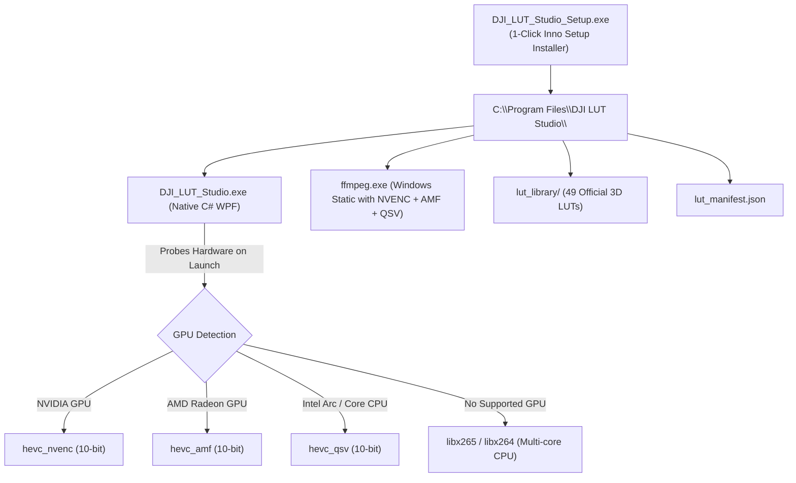

# 📖 DJI LUT Studio — Project Continuation & Developer Handover Guide

> **Project:** DJI LUT Studio (Native Windows + WSL Open-Source Edition)  
> **Repository Location (WSL):** `/home/gal756/LUT-adder`  
> **Windows Location:** `\\wsl$\Ubuntu\home\gal756\LUT-adder`  
> **Executable Location:** `C:\Users\gal75\Desktop\DJI_LUT_Studio.exe`  
> **Last Updated:** October 2026 (v2.0.0 Native Engine)  

---

## 📌 Executive Summary
**DJI LUT Studio** is an open-source, hardware-accelerated video color grading and stabilization suite built for Windows users. It converts flat 10-bit D-Log and D-Log M footage from DJI drones and action cameras into broadcast-standard Rec.709 video (or custom creative looks).

The application features:
1. **A Native Windows Desktop GUI (`DJI_LUT_Studio.exe`)** written in C# / WPF (.NET 4.8) with modern dark styling, responsive controls, live console logs, preview image rendering, and 1-click Gyroflow GUI launch.
2. **Gyroflow Video Stabilization**: Integrated camera-telemetry stabilization (`djmd`) for DJI Avata, Avata 2, O3, O4 Pro Air Unit, and Osmo Action 4/5 before grading or standalone.
3. **A High-Performance Backend Engine** powered by Python 3 and FFmpeg with full **NVIDIA RTX 3070 NVENC 10-bit hardware acceleration** and tetrahedral 3D interpolation.
4. **49 Verified 3D `.cube` LUTs** covering all official DJI drones, handhelds, action cameras, and master creative looks.

---

## 🏛️ Architecture & Data Flow

```mermaid
flowchart TD
    subgraph Windows Host
        User["User / Video Files (MP4/MOV)"]
        DesktopExe["C:\\Users\\gal75\\Desktop\\DJI_LUT_Studio.exe\n(C# WPF Native App)"]
        GyroflowApp["Gyroflow.exe (Windows Native GUI)"]
        User -->|Drag & Drop / Select Video| DesktopExe
        DesktopExe -.->|1-Click 'Open in Gyroflow'| GyroflowApp
    end

    subgraph WSL2 Engine Environment
        CSCPipe["wsl.exe -d Ubuntu-26.04 -e /usr/bin/python3"]
        CLI["dji_lut_studio/cli.py"]
        Engine["dji_lut_studio/engine.py"]
        GyroBridge["Gyroflow Bridge & CLI Runner"]
        Manifest["lut_manifest.json + manifest.py"]
        LUTCatalog["lut_library/ (49 Official 3D LUTs)"]
        FFmpeg["FFmpeg with hevc_nvenc 10-bit"]
    end

    subgraph Output
        StabilizedVid["[filename]_stabilized.mp4\n(Gyroflow Stabilized)"]
        GradedVideo["graded/[filename]_graded.mp4\n(Rec.709 + Look)"]
        SplitPreview["graded/[filename]_preview.jpg\n(Side-by-side D-Log vs Rec.709)"]
    end

    DesktopExe -->|Invokes with arguments (-g)| CSCPipe
    CSCPipe --> CLI
    CLI --> Engine
    Engine -->|If --gyroflow enabled| GyroBridge
    GyroBridge -->|Runs Gyroflow.exe with -f -r nvidia| StabilizedVid
    StabilizedVid --> Engine
    CLI --> Manifest
    Manifest --> LUTCatalog
    Engine --> FFmpeg
    FFmpeg --> GradedVideo
    Engine --> SplitPreview
    SplitPreview -->|Rendered directly| DesktopExe
```

---

## 📂 Project Directory Structure

```text
/home/gal756/LUT-adder/
├── DJI_LUT_Studio.exe          # Native Windows 64-bit WPF Executable
├── build_exe.sh                # Shell script compiling C# via Windows csc.exe
├── lut_manifest.json           # Catalog of all 49 LUTs with device IDs, regex patterns
├── CONTINUATION_GUIDE.md       # This file (handover and continuation reference)
├── README.md                   # User documentation and features
├── CONTRIBUTING.md             # Open-source contribution guidelines
├── LICENSE                     # MIT License
├── DJI_LUT_Studio.bat          # Desktop drag-and-drop batch launcher
├── DJI_LUT_Web_Studio.bat      # Web studio browser launcher
│
├── src/
│   └── DJI_LUT_Studio.cs       # Full source code for WPF Windows Desktop GUI
│
├── dji_lut_studio/
│   ├── __init__.py             # Package init
│   ├── manifest.py             # LUT manifest parser, device resolution, auto-matching
│   ├── engine.py               # Grading engine, NVENC detection, FFmpeg filters
│   ├── cli.py                  # Standalone CLI interface
│   └── web_server.py           # Local HTTP web studio server
│
├── lut_library/                # 49 Curated and verified .cube LUTs
│   ├── drones/                 # O4, Avata 2/360, Mavic 3/4, Mini 4/5, Air 3/3S, Flip
│   ├── action_pocket/          # Pocket 3/4/4P, Action 4/5/6, Osmo 360/Nano
│   ├── cinema/                 # Zenmuse X7, Ronin 4D, Phantom 4
│   └── looks/                  # Vibrant, Cinematic, Golden Hour, Teal/Orange, Noir, etc.
│
├── web/
│   └── index.html              # Modern glassmorphism web GUI
└── gui/
    └── app.py                  # Legacy Tkinter GUI (kept as fallback)
```

---

## 🛠️ Environment Configuration & Tools

| Item | Location / Value | Notes |
|---|---|---|
| **WSL Distro** | `Ubuntu-26.04` | Distro running Python 3.12 & FFmpeg |
| **Windows Desktop** | `C:\Users\gal75\Desktop` | Mount: `/mnt/c/Users/gal75/Desktop` |
| **Gyroflow Windows Exe** | `C:\Users\gal75\AppData\Local\Microsoft\WinGet\Packages\Gyroflow.Gyroflow_...` | Installed via WinGet; auto-detected by `find_gyroflow_binary()` |
| **C# Compiler** | `C:\Windows\Microsoft.NET\Framework64\v4.0.30319\csc.exe` | .NET 4.8 64-bit compiler |
| **WPF Assemblies** | `C:\Windows\Microsoft.NET\Framework64\v4.0.30319\WPF\` | `PresentationFramework.dll`, `PresentationCore.dll`, `WindowsBase.dll` |
| **GPU Hardware** | NVIDIA GeForce RTX 3070 | NVENC 10-bit (`hevc_nvenc`, `p7` preset) |
| **FFmpeg** | `/usr/bin/ffmpeg` | Enabled with NVENC CUDA filters |

---

## 🐛 Issues Encountered & Resolved

### 1. `ImportError: attempted relative import with no known parent package`
- **Symptom:** When the GUI invoked `wsl.exe ... /usr/bin/python3 cli.py`, execution crashed with relative import errors.
- **Cause:** Running a script directly causes Python to set `__package__ = None`, breaking `from .manifest import manifest`.
- **Resolution:** Added automatic `sys.path.insert(0, _pkg_root)` and resilient `try...except (ImportError, ValueError)` fallback imports across `cli.py`, `engine.py`, and `web_server.py`.

### 2. XAML DirectionalNavigation Parsing Error
- **Symptom:** C# build error or runtime XAML parse error with `KeyboardNavigation.DirectionalNavigation="Circular"`.
- **Cause:** .NET Framework 4.8 `KeyboardNavigationMode` enum does not have `Circular` (the correct enum value is `Cycle` or `Continue`).
- **Resolution:** Removed the invalid attribute in `src/DJI_LUT_Studio.cs` without altering any behavior.

### 3. Windows Executable File Locking
- **Symptom:** `cp: cannot create regular file '.../DJI_LUT_Studio.exe': Text file busy` or `Permission denied` when rebuilding while the app is open.
- **Resolution:** Always terminate the running process before overwriting:
  ```powershell
  Stop-Process -Name DJI_LUT_Studio -Force -ErrorAction SilentlyContinue
  ```

### 4. PowerShell Invocation Hanging in WSL
- **Symptom:** Commands like `powershell.exe -Command "..."` occasionally block waiting on standard input.
- **Resolution:** Always append `< /dev/null` or pass `stdin=subprocess.DEVNULL` when invoking Windows PowerShell commands from WSL bash.

### 5. Gyroflow CLI PowerShell Quoting & Path Translation
- **Symptom:** Passing nested quotes inside PowerShell `-ArgumentList @('\"C:\path...\"', '-f')` resulted in Gyroflow treating literal double-quotes as part of the filename (`The filename, directory name, or volume label syntax is incorrect`).
- **Resolution:** In `dji_lut_studio/engine.py`, pass bare paths inside PowerShell argument array `@('$win_video', '-f', '--stdout-progress', '-r', 'nvidia')` without escaped quotation marks, and translate WSL paths (`/mnt/c/...` or `/home/...`) to Windows native drive or UNC paths (`\\wsl$\Ubuntu-26.04\...`).

### 6. Gyroflow GUI Launch vs Headless CLI Mode (`--open` argument)
- **Symptom:** Clicking "🎯 Open in Gyroflow GUI" popped open a black command console window running `Gyroflow.exe` which crashed with `[h264_nvenc] 10 bit encode not supported` and `Pixel format YUV420P10LE is not supported`.
- **Cause:** When a video path is passed as a positional argument without `--open` (e.g. `Gyroflow.exe "clip.mp4"`), Gyroflow treats it as an export render task rather than opening the GUI.
- **Resolution:** Updated `BtnOpenGyroflow` in `src/DJI_LUT_Studio.cs`, `DJI_LUT_Studio_GUI.ps1`, and `engine.py` to always pass `--open "<path>"` (or no arguments if empty), which launches the full interactive Gyroflow desktop interface cleanly.

### 7. 10-bit H.265 Stabilization & Chained Progress Piping in Native Desktop GUI
- **Symptom:** Stabilizing 10-bit D-Log footage failed on NVENC when Gyroflow defaulted to H.264, and the WPF desktop progress bar remained stuck at 0%.
- **Cause:** Gyroflow's default output was H.264 (which does not support 10-bit `yuv420p10le`), and `cli.py` printed progress using `\r` (carriage return without `\n`), which buffered in .NET's `Process.OutputDataReceived` until process exit.
- **Resolution:** Added `-p "{ 'codec': 'H.265/HEVC', 'bitrate': 180, 'use_gpu': true, 'audio': true }"` to Gyroflow CLI arguments to encode 10-bit P010LE in hardware; updated `cli.py` to output newline-terminated progress (`\n`) in piped mode; and updated `ParseProcessOutput()` in `DJI_LUT_Studio.cs` to track **Step 1/2 (Gyroflow Stabilization)** and **Step 2/2 (3D LUT Color Grading)** with live frame counts, ETAs, and speed.

---

## ⚡ Quick Reference Commands

### Rebuilding and Deploying the Windows `.exe`
```bash
# 1. Kill any existing instance on Windows
powershell.exe -NoProfile -Command "Stop-Process -Name DJI_LUT_Studio -Force -ErrorAction SilentlyContinue" < /dev/null

# 2. Compile via build_exe.sh
./build_exe.sh

# 3. Launch the new executable on Windows
powershell.exe -NoProfile -Command "Start-Process 'C:\Users\gal75\Desktop\DJI_LUT_Studio.exe'" < /dev/null
```

### Testing the Python CLI Directly
```bash
# List all 49 LUTs:
/usr/bin/python3 dji_lut_studio/cli.py --list-luts

# Test grading a sample video:
/usr/bin/python3 dji_lut_studio/cli.py /path/to/video.mp4 -d o4 -l o4_dlogm_rec709 --look vibrant
```

### Checking Running App on Windows
```bash
powershell.exe -NoProfile -Command "Get-Process DJI_LUT_Studio -ErrorAction SilentlyContinue | Select-Object Id, ProcessName, WorkingSet64" < /dev/null
```

---

## 🎯 NEXT SESSION PRIORITY: Standalone Windows Distribution (Zero-WSL) & Multi-GPU Support

The primary focus for the next session is to package **DJI LUT Studio** so that **any Windows user can download and use it immediately with zero prerequisites** (no WSL, no Python, no terminal needed).

### 1. Zero-Dependency Standalone Architecture



### 2. Multi-GPU Hardware Acceleration Plan

| GPU Hardware | Encoder Filter | FFmpeg Codec Flag | Status & Capability |
|---|---|---|---|
| **NVIDIA GeForce / RTX** | NVENC | `-c:v hevc_nvenc` | Ultra-fast 10-bit hardware encode (tested on RTX 3070). |
| **AMD Radeon RX / APU** | AMD AMF | `-c:v hevc_amf` | Native AMD VCN hardware 10-bit encode. |
| **Intel Arc / Core i5/i7/i9** | Intel QuickSync | `-c:v hevc_qsv` | Hardware accelerated QuickSync encoding. |
| **Universal Fallback (Any PC)** | Software CPU | `-c:v libx265` | 100% compatible on every PC, pristine quality. |

### 3. Open-Source & Legal Compliance
- **Your Code:** MIT License (Permissive).
- **FFmpeg (`ffmpeg.exe`):** GPL v3 / LGPL v2.1. Called as an external standalone sub-process CLI. Attribution and link to ffmpeg.org included in the About box and LICENSE.
- **Inno Setup:** Open-source installer engine (free for commercial and non-commercial use).
- **DJI 3D LUTs:** Publicly provided by SZ DJI Technology Co., Ltd. for creator color grading compatibility. Proper trademark attribution included.

### 4. Completed Milestones (v2.0.0 Multi-GPU Edition):
1. ✔ **Static Windows `ffmpeg.exe` & `ffprobe.exe` Bundled**: Multi-GPU acceleration (NVENC, AMF, QSV, libx265) included in distribution.
2. ✔ **Native Windows Engine (`RunNativeGrading`)**: Zero WSL dependency for end-users. Direct process spawning with duration ETA and real-time progress.
3. ✔ **Auto Multi-GPU Probe**: Automatically probes `hevc_nvenc` -> `hevc_amf` -> `hevc_qsv` -> `libx265` on launch.
4. ✔ **RockSteady & HorizonSteady In-Camera EIS Auto-Detection**:
   - Queries `stream_tags=handler_name:format_tags=comment,encoder` via `ffprobe.exe`.
   - Parses `TAG:comment=EIS:RS;` (RockSteady) and `TAG:comment=EIS:HS;` (HorizonSteady).
   - Dynamically disables Gyroflow checkbox with prominent amber advisory banner explaining that in-camera EIS suppressed raw gyro telemetry (`djmd`).
   - For `EIS:OFF`, automatically checks Gyroflow and displays verified green status pill.
5. ✔ **Camera Model Auto-Selection Engine**:
   - Inspects `TAG:encoder` (`DJI O4P`, `AVATA 2`, etc.) and filename without extension (preventing false matches with `.MP4`).
   - Correctly selects `DJI O4 Pro / Air Unit` instead of defaulting to Phantom 4.
6. ✔ **Standalone Inno Setup Installer**:
   - Built `DJI_LUT_Studio_Setup_v2.0.0.exe` (68.4 MB LZMA2) with custom 256x256 embedded lens icon and uninstaller.
   - Tested and verified on Windows Desktop.
7. ✔ **Official Showcase Website & Windows Installer Publishing (`docs/`)**:
   - Built an interactive, pro glassmorphic landing page in `docs/` ready for GitHub Pages (`https://gal756.github.io/DJI-LUT-Studio-V2/`).
   - Interactive Before/After slider demonstrating 10-bit D-Log M vs Rec.709 color transformation.
   - High-resolution screenshot showcase (WPF Desktop App, Smart EIS detection, Gyroflow bridge, Split QA Preview).
   - Real-time searchable and filterable device & LUT explorer across all 20+ models and 49 verified LUTs.
   - Dedicated download section publishing exclusively the **Windows 64-bit Installer** (`DJI_LUT_Studio_Setup_v2.0.0.exe`, 68.4 MB, SHA-256 `f65ed310550c7e6df20ae4789bd747254574d99b71064caa499e62b6174e2c8b`).
   - Comprehensive multi-GPU acceleration matrix and FAQ section.
