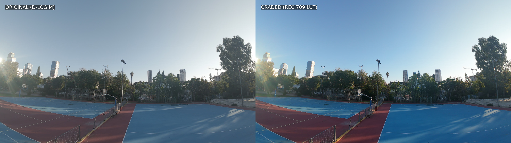
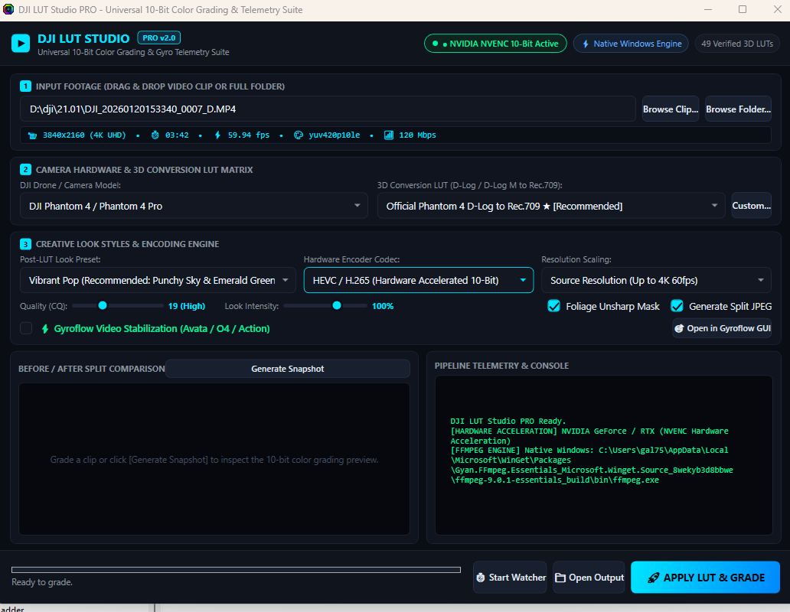

# 🎬 DJI LUT Studio (Windows Open-Source Edition)

[](LICENSE)
[](#)
[](#)
[](#)
[](https://gal756.github.io/LUT-adder/)
[-00e5ff.svg)](https://github.com/gal756/LUT-adder/releases/download/v2.0.0/DJI_LUT_Studio_Setup_v2.0.0.exe)

> **🌐 Live Interactive Showcase & Web Page:** [https://gal756.github.io/LUT-adder/](https://gal756.github.io/LUT-adder/)  
> **⬇️ Official 1-Click Windows Download:** [**`DJI_LUT_Studio_Setup_v2.0.0.exe`**](https://github.com/gal756/LUT-adder/releases/download/v2.0.0/DJI_LUT_Studio_Setup_v2.0.0.exe) *(68.4 MB &bull; Standalone 64-bit &bull; Zero WSL or Python needed)*

**DJI LUT Studio** is an open-source, multi-GPU accelerated video color grading and stabilization software application designed for Windows 10 & 11. It packages **all 49 official DJI 3D conversion LUTs** alongside calibrated cinematic looks, giving creators a simple, professional, 1-click tool to grade flat 10-bit D-Log and D-Log M drone and action camera footage into rich, broadcast-grade Rec.709 video.

---

### 🖼️ Real-World D-Log M vs Rec.709 Graded Preview


### 🖥️ Native Windows Desktop GUI (WPF Multi-GPU)


---

## ⚡ Highlights & Features

- **Multi-GPU Hardware Acceleration**: Native 10-bit pipeline auto-detecting and accelerating across all major GPU vendors:
  - **NVIDIA**: GeForce GTX/RTX hardware encoding via **NVENC** (`hevc_nvenc`, `h264_nvenc`)
  - **AMD**: Radeon RX / Radeon Pro hardware encoding via **AMF** (`hevc_amf`, `h264_amf`)
  - **Intel**: Arc A-Series & Core Iris Xe hardware encoding via **Quick Sync Video** (`hevc_qsv`, `h264_qsv`)
  - **Universal CPU Fallback**: Multi-core SIMD software rendering via `libx265` / `libx264`
- **Complete Official DJI LUT Library (49 LUTs)**: Includes calibrated `.cube` conversion LUTs for O4 Air Unit, Avata 2, Mavic 3, Mavic 4 Pro, Mini 4/5 Pro, Air 3/3S, Osmo Pocket 3/4, Osmo Action 4/5/6, Zenmuse X7, Phantom 4, and official Master Creative Looks!
- **Gyroflow Video Stabilization**: Seamless built-in integration with [Gyroflow](https://gyroflow.xyz/)! Automatically detects camera-embedded gyro motion telemetry (`djmd`) from DJI Avata, Avata 2, O3 Air Unit, O4 Pro Air Unit, and Osmo Action 4/5 to stabilize shaky drone and action camera footage before applying 3D LUTs. Includes a 1-click **🎯 Open in Gyroflow GUI** launcher for fine-tuning horizon lock, FOV, and smoothing presets.
- **Standalone Windows Installer**: Packaged as a single-click installer (`DJI_LUT_Studio_Setup_v2.0.0.exe`) bundling the GUI, FFmpeg, and the full LUT library—100% self-contained with zero WSL or Python requirements for end-users!
- **Dual Windows GUI Experiences**:
  1. **Native Windows Desktop GUI (WPF)**: A standalone desktop app written in modern dark-theme XAML with model dropdowns, custom LUT loader, file browse, and real-time progress.
  2. **Modern Web Studio GUI**: An interactive, glassmorphism web interface accessible locally in your browser with device cards, LUT descriptions, and split-screen previews.
- **Windows Desktop Drag & Drop**: Drag videos or folders directly onto the application icon on your Windows Desktop to grade instantly.
- **Side-by-Side Comparison Previews**: Automatically generates a split comparison JPEG (`ORIGINAL (D-LOG)` vs `GRADED (Rec.709)`) for instant quality verification.
- **Intelligent Auto-Detection**: Analyzes video metadata and filenames to automatically select the matching drone/camera profile and recommended LUT.
- **Continuous Folder Watcher**: Monitored incoming folder mode (e.g. `D:\dji\incoming`) that automatically color grades footage as soon as you offload your SD card.

---

## 🚁 Supported DJI Cameras & LUT Catalog

| Category | Supported Devices | Available LUT Profiles |
|---|---|---|
| **Drones & Air Units** | **DJI O4 Pro / Air Unit** | Official D-Log M to Rec.709 V1 (Recommended) |
| | **DJI Avata 2** | Official Avata 2 D-Log M to Rec.709 V1 |
| | **DJI Avata 360** | Official Avata 360 D-Log M to Rec.709 |
| | **DJI Mavic 3 / Pro / Cine** | Official D-Log to Rec.709 (Standard & Vivid), D-Log M |
| | **DJI Mavic 4 Pro** | Official D-Log to Rec.709 (Standard & Vivid), D-Log M |
| | **DJI Air 3 & Air 3S** | Official Air 3 & Air 3S D-Log M to Rec.709 |
| | **DJI Mini 4 Pro & Mini 5 Pro**| Official Mini 4 & Mini 5 Pro D-Log M to Rec.709 |
| | **DJI Flip** | Official DJI Flip D-Log M to Rec.709 |
| **Action & Pocket** | **DJI Osmo Pocket 3** | Official D-Log M + Master Looks: Spring, Summer, Autumn, Winter Pro |
| | **DJI Osmo Pocket 4 / 4 Pro** | Official D-Log & D-Log2 to Rec.709 (Standard & Vivid) |
| | **DJI Osmo Action 4** | Official D-Log M + Action Looks: Ice Pro, Nature Pro, Forest Pro |
| | **DJI Osmo Action 5 Pro** | Official D-Log M + Master Looks: Mei, Ju, Zhu, Lan |
| | **DJI Osmo Action 6** | Official Action 6 D-Log M to Rec.709 |
| | **DJI Osmo 360** | Official Osmo 360 D-Log M to Rec.709 |
| | **DJI Osmo Nano** | Official Osmo Nano D-Log M to Rec.709 |
| | **DJI Lito / Lito X1** | Official Lito X1 D-Log M to Rec.709 |
| | **DJI Neo / Generic** | Universal DJI D-Log M to Rec.709 |
| **Cinema & Enterprise**| **DJI Zenmuse X7 / Ronin 4D** | Official Cinema D-Log to Rec.709, Linear to D-Log |
| | **DJI Phantom 4 / Pro** | Official Phantom 4 D-Log to Rec.709 & sRGB Improv |
| **Creative Film Styles**| **Universal Looks** | Vibrant Pop, Cinematic 35mm Film, Golden Hour, Teal & Orange, Clean Commercial, Moody Noir B&W, D-Cinelike Natural Booster |

---

## 🚀 How to Install & Use on Windows

### 1-Click Windows Installer (Recommended for All Users)
1. Download [**`DJI_LUT_Studio_Setup_v2.0.0.exe`**](https://github.com/gal756/LUT-adder/releases/download/v2.0.0/DJI_LUT_Studio_Setup_v2.0.0.exe) *(68.4 MB)*.
   - **SHA-256:** `f65ed310550c7e6df20ae4789bd747254574d99b71064caa499e62b6174e2c8b`
2. Run the setup wizard — all components (Native WPF App, Multi-GPU FFmpeg 7.x, 49 Official LUTs) are bundled. **Zero WSL or Python required!**
3. Double-click the **DJI LUT Studio** shortcut on your Desktop or Start Menu.
4. Drag and drop any DJI video or folder:
   - Camera model and gyro status are detected automatically.
   - Click **`🚀 APPLY LUT & GRADE`**.
   - Watch real-time encoding progress, view the side-by-side preview JPEG, and open your graded clip!

### Drag & Drop directly onto Desktop Icon
- Drag and drop any DJI `.MP4` or `.MOV` file directly onto the **DJI LUT Studio** icon on your Windows Desktop to launch and grade immediately.

### Alternative: Modern Web Studio GUI
1. Double-click **`DJI_LUT_Web_Studio.bat`** on your Desktop.
2. Your browser will automatically launch at `http://localhost:8080`.
3. Pick your drone from the visual device cards, select a LUT, scan your clips, view instant side-by-side previews, and click **Apply LUT & Grade**.

### Option 4: Linux / WSL Terminal CLI
```bash
# List all 49 LUTs and device IDs
./grade.sh --list-luts

# Grade a video with auto-detection:
./grade.sh /mnt/d/dji/DJI_0001.MP4

# Grade with specific camera and LUT:
./grade.sh /mnt/d/dji/clip.mp4 -d mavic_3 -l m3_dlog_rec709_vivid --look cinematic

# Watch folder continuously:
./grade.sh -w /mnt/d/dji/incoming -o /mnt/d/dji/graded --look vibrant
```

---

## ⚙️ CLI Reference

```
python3 -m dji_lut_studio.cli [inputs...] [options]
```

| Flag | Description | Default |
|---|---|---|
| `inputs` | Video file(s) or folder(s) to process | Interactive if empty |
| `-d, --camera` | Camera/Drone ID (`o4`, `avata_2`, `mavic_3`, `pocket_3`, `action_5_pro`, etc.) | Auto-detect |
| `-l, --lut` | LUT identifier or direct path to any custom `.cube` file | Recommended for device |
| `--look` | Creative post-LUT style (`natural`, `vibrant`, `cinematic`, `golden`, `teal_orange`) | `natural` |
| `-c, --codec` | Video codec: `hevc` (10-bit NVENC), `h264`, `prores` (422 HQ) | `hevc` |
| `--cq` | Constant Quality factor (15-28; lower = higher bitrate & quality) | `19` |
| `--scale` | Output resolution: `keep`, `4k`, `2.7k`, `1080p` | `keep` |
| `--sharpen` | Apply subtle fine-detail unsharp mask | Off |
| `-g, --gyroflow` | Stabilize video with Gyroflow before grading (Avata, O3, O4, Action 4/5) | Disabled |
| `--open-gyroflow` | Launch input video directly in the Gyroflow Desktop GUI | - |
| `--gyroflow-preset` | Optional Gyroflow preset `.json` path for custom horizon lock & FOV | Auto-detect |
| `-p, --preview` | Generate comparison JPEG (`_preview.jpg`) | Enabled |
| `-o, --output` | Output folder directory | `graded/` next to clip |
| `-w, --watch` | Continuous directory watcher mode | Disabled |
| `--overwrite` | Overwrite existing output files | Skip existing |
| `--list-devices`| Print all supported DJI drones and cameras | - |
| `--list-luts` | Print full catalog of all 49 LUTs | - |

---

## 📂 Project Architecture

```
LUT-adder/
├── DJI_LUT_Studio.exe          # Native Windows 64-bit WPF Executable
├── DJI_LUT_Studio.bat          # Main Windows launcher (Desktop shortcut)
├── DJI_LUT_Web_Studio.bat      # 1-Click browser GUI launcher
├── build_exe.sh                # Script compiling native Windows C# WPF app
├── grade.sh                    # Universal Linux / WSL CLI script
├── lut_manifest.json           # Master database of 49 DJI LUTs & devices
├── lut_library/                # Official & Creative 3D LUTs (.cube files)
│   ├── drones/                 # O4, Avata 2, Mavic 3/4, Air 3/3S, Mini 4/5, Flip
│   ├── action_pocket/          # Pocket 3/4, Action 4/5/6, Osmo 360, Nano, Lito
│   ├── cinema/                 # Zenmuse X7, Phantom 4, Cinema Log
│   ├── creative/               # Master Looks (Action 5 Pro Mei/Ju, Pocket 3 seasons)
│   └── looks/                  # Vibrant Pop, Cinematic Film, Golden Hour, Teal & Orange
├── src/
│   └── DJI_LUT_Studio.cs       # C# WPF Native Desktop GUI with Gyroflow support
├── dji_lut_studio/             # Core Python grading engine & CLI
│   ├── __init__.py
│   ├── manifest.py             # Manifest loader & auto-detection engine
│   ├── engine.py               # NVENC 10-bit pipeline, tetrahedral LUTs & Gyroflow bridge
│   ├── cli.py                  # Full CLI, interactive terminal wizard & Gyroflow commands
│   └── web_server.py           # Embedded local HTTP REST & SSE server
├── gui/
│   └── DJI_LUT_Studio_GUI.ps1  # Native Windows WPF Dark Theme Desktop GUI (PowerShell script)
├── web/                        # Modern Web Studio Single-Page App
│   ├── index.html              # Responsive UI with device cards, LUT selector & Gyroflow controls
│   ├── style.css               # Dark glassmorphic stylesheet
│   └── app.js                  # Frontend application controller
├── LICENSE                     # Open Source MIT License
├── CONTRIBUTING.md             # Community contribution guide
└── README.md                   # Documentation
```

---

## 📚 Developer & Continuation Guide
Looking to resume development, understand the internal architecture, or build the native executable from source?  
See the full **[CONTINUATION_GUIDE.md](CONTINUATION_GUIDE.md)** for architecture diagrams, build instructions, and the roadmap.

---

## 📄 License
This project is licensed under the open-source **MIT License** - see the [LICENSE](LICENSE) file for details.
All official DJI 3D LUTs are property of SZ DJI Technology Co., Ltd.
